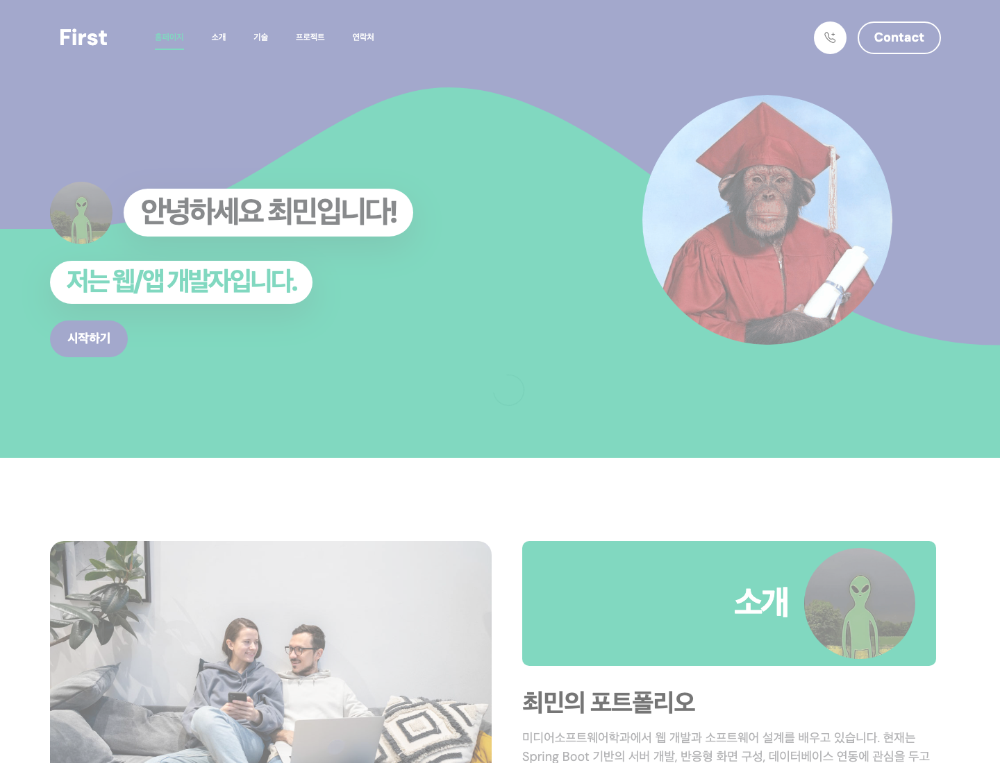
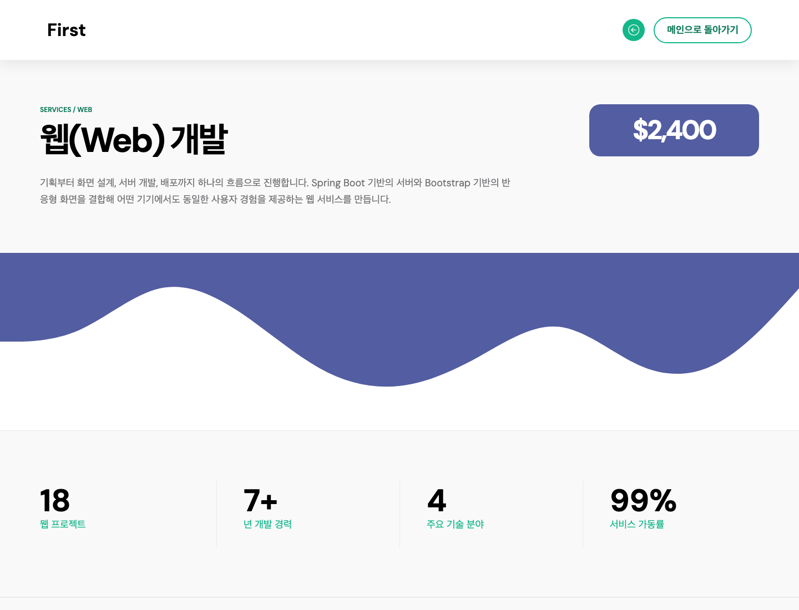
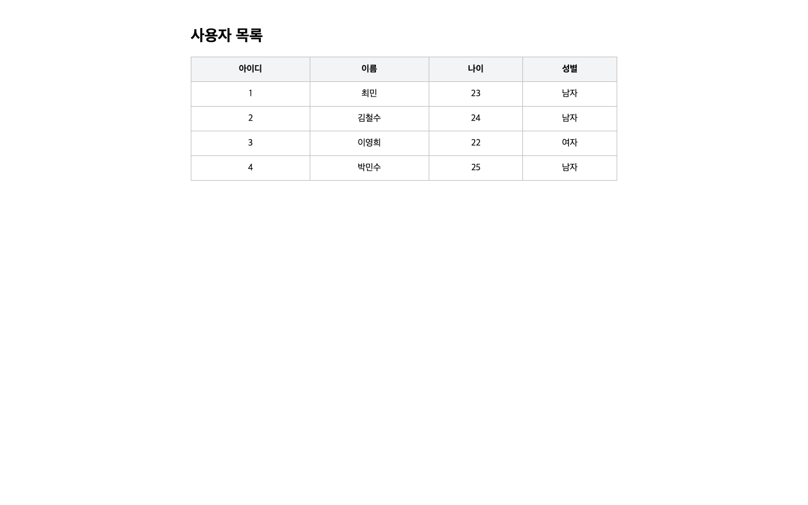
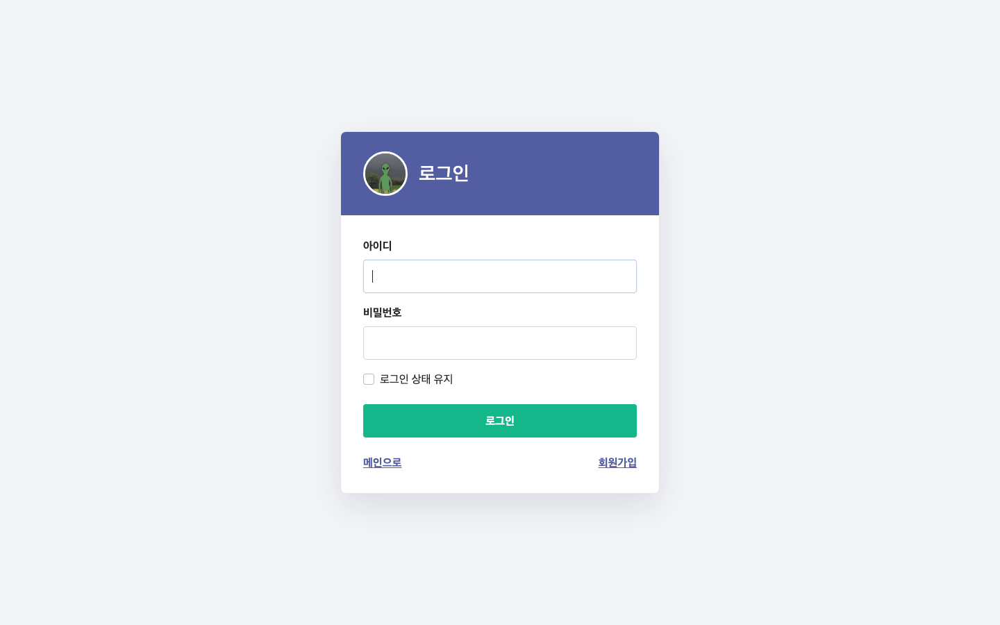
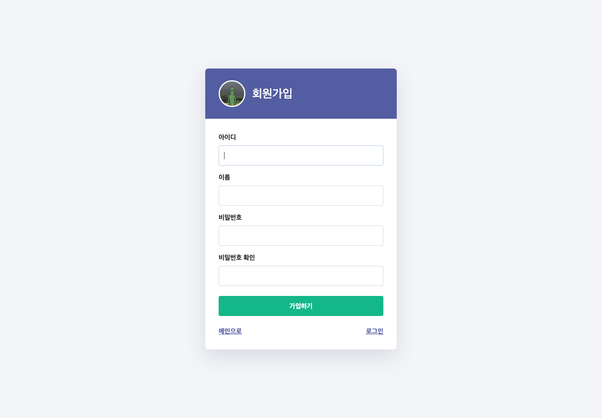
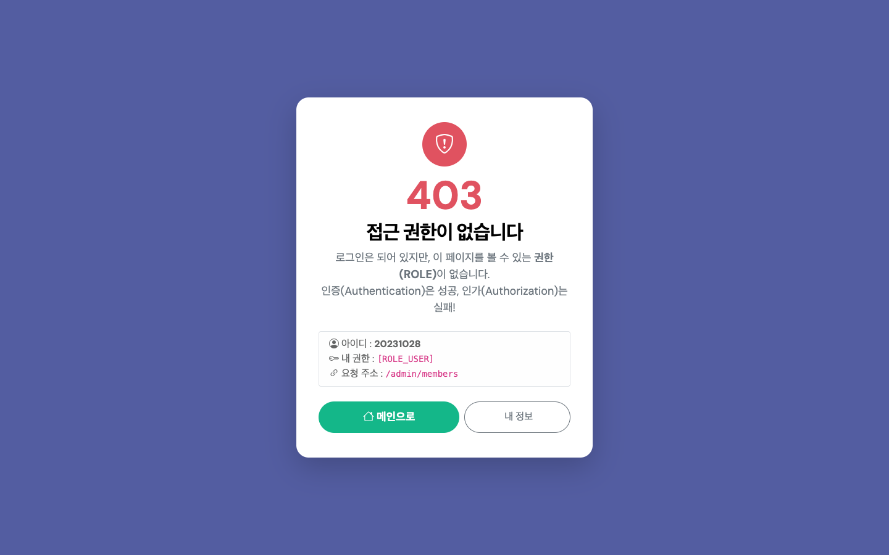
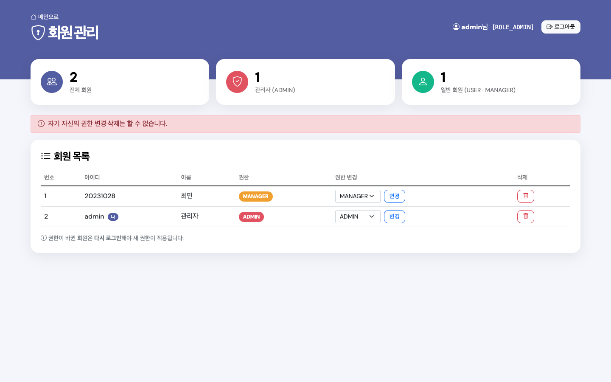
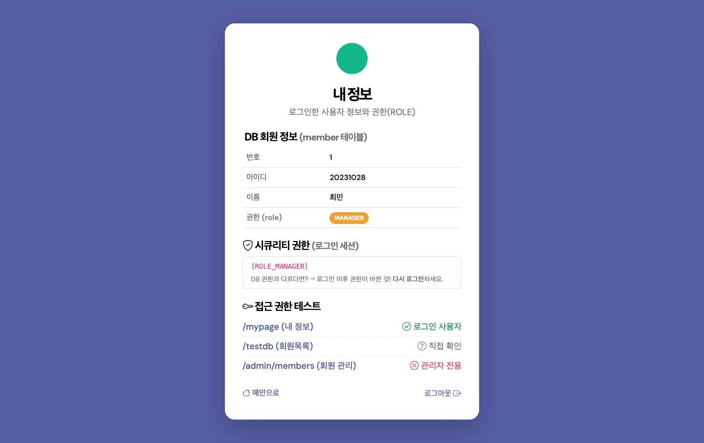
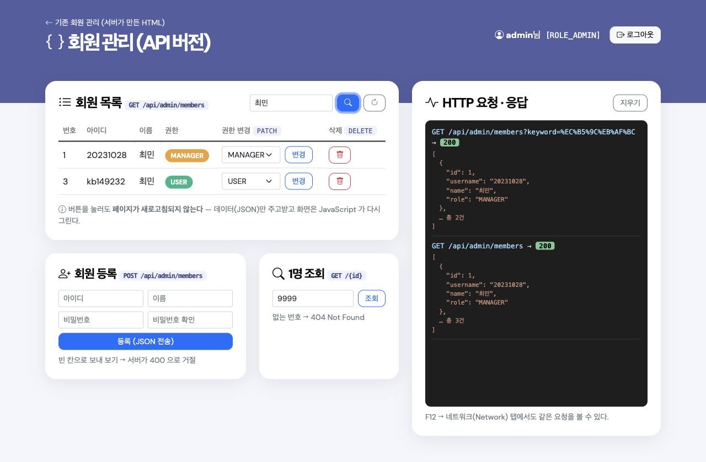

# 자바웹프로그래밍(2) 2주차 - 스프링 부트 개발환경 설정 및 테스트

VS Code에 스프링 부트 개발환경을 세팅하고 Thymeleaf로 첫 화면을 띄운 뒤 URL 맵핑과 컨트롤러까지 만들어 봤다. 강의 자료 순서를 그대로 따라가며 실습했고 마지막 연습문제도 풀어서 넣었다.

20231028 최민

## 개발 환경

| 항목 | 내용 |
|---|---|
| IDE | Visual Studio Code |
| 확장 | Extension Pack for Java, Spring Boot Extension Pack |
| 빌드 도구 | Maven |
| Spring Boot | 4.1.1 |
| Java | 21 (LTS) |
| 패키징 | Jar |
| 템플릿 엔진 | Thymeleaf 3.1.5 |
| WAS | 내장 Apache Tomcat 11, 8080 포트 |

강의 자료는 Java 25를 권장하지만 최소 요구 버전이 17이라 노트북에 이미 깔려 있던 21로 진행했다.

## 선택한 의존성

Spring Initializr에서 7가지를 골랐다. Spring Web, Thymeleaf, Spring Boot DevTools, Lombok, Spring Configuration Processor까지 다섯 개는 바로 쓰고 있고 Spring Data JPA와 MySQL Driver는 `pom.xml`에서 주석 처리해 뒀다.

DB를 아직 안 붙였는데 JPA가 살아 있으면 실행하자마자 데이터소스를 못 찾아서 죽는다. 강의 자료 17페이지에서 알려준 대로 해당 의존성 세 덩어리를 주석으로 막으니 8080 포트가 정상적으로 떴다. DB 실습에 들어가는 주차에 주석만 풀면 된다.

## 폴더 구조

```
src/
 └ main/
    ├ java/com/example/demo/
    │   ├ DemoApplication.java   # @SpringBootApplication, 프로그램 시작점
    │   └ DemoController.java    # URL 맵핑 컨트롤러
    └ resources/
       ├ templates/              # Thymeleaf 뷰
       │   ├ index.html          # 메인 페이지
       │   ├ hello.html          # /hello
       │   └ hello2.html         # /hello2, 연습문제
       ├ static/                 # css, js, images
       └ application.properties  # 포트, 캐시 설정
pom.xml                          # 빌드 및 종속성 설정
```

## 실행 방법

VS Code에서 `DemoApplication.java`를 열고 디버그 없이 실행(Ctrl + F5)하면 내장 톰캣이 뜬다. 터미널에서 직접 돌려도 된다.

```bash
./mvnw spring-boot:run
```

접속 주소는 셋이다.

- <http://localhost:8080/> 메인 페이지
- <http://localhost:8080/hello> 컨트롤러가 넘긴 값을 출력
- <http://localhost:8080/hello2> 연습문제 페이지

## 실습하면서 정리한 것

**index.html** — `resources/templates` 안에 만들었다. 기존 HTML5 문법을 그대로 쓰되 `<html>` 태그에 `xmlns:th`를 선언해야 Thymeleaf 문법이 먹는다. 처음에 링크를 `/hello.html`로 걸었더니 404가 났다. 파일 이름으로 직접 접근하는 방식이 아니라 컨트롤러가 매핑한 주소로 들어가야 해서였다. `/hello`로 고치니 연결됐다.

**DemoController.java** — `@Controller`를 붙이고 `@GetMapping("/hello")`으로 GET 요청을 받는다. `model.addAttribute("data", ...)`로 값을 담고 `"hello"`를 리턴하면 리턴한 이름과 같은 `hello.html`을 찾아서 렌더링한다. 파일 이름과 리턴값의 대소문자가 어긋나면 바로 에러가 나니 조심해야 한다.

**동작 순서** — 브라우저가 `/hello`를 요청하면 DispatcherServlet이 프론트 컨트롤러 역할로 받아서 컨트롤러에 넘긴다. 컨트롤러는 Model에 데이터를 담고 뷰 이름을 돌려준다. 그러면 Thymeleaf가 서버에서 HTML을 완성해 응답한다. MVC로 보면 Model은 페이지 정보, View는 Thymeleaf 화면, Controller는 흐름 제어를 맡는다.

## 연습문제

`/hello2` 맵핑을 새로 추가하고 속성 다섯 개를 출력했다.

컨트롤러의 `hello2()` 메서드에서 학과, 학번, 이름, 과목, 주차를 Model에 담고 `hello2.html`에서 `th:text="${...}"`로 하나씩 찍었다. `hello.html`의 링크도 `/hello2`로 바꿔서 메인에서 두 번째 페이지까지 클릭만으로 넘어간다.

실행해서 다섯 값이 전부 화면에 나오는지 확인했고 `./mvnw test`도 통과했다.

### 실습 결과

`/hello`의 링크를 눌러 `/hello2`로 넘어가는 흐름이다. 오른쪽 화면에 컨트롤러가 담은 다섯 속성이 그대로 찍혔다.

| `/hello` | `/hello2` |
|---|---|
|  |  |

---

# 자바웹프로그래밍(2) 3주차 - 포트폴리오 작성하기

TemplateMo 578 First Portfolio 원본 템플릿을 스프링 부트 프로젝트에 넣고, 웹/AI/보안/앱 기술 영역으로 수정했다. 강의 자료에서 안내한 것처럼 상세 페이지는 `resources/public` 폴더에 넣어서 컨트롤러를 새로 만들지 않고 바로 접근하게 했다.

20231028 최민

## 개발 환경

| 항목 | 내용 |
|---|---|
| IDE | Visual Studio Code |
| 빌드 도구 | Maven |
| Spring Boot | 4.1.1 |
| Java | 21 (LTS) |
| 템플릿 엔진 | Thymeleaf |
| 프론트엔드 | HTML, CSS, Bootstrap 5, Bootstrap Icons |
| 정적 페이지 위치 | `src/main/resources/public` |

가져온 `templatemo_578_first_portfolio.zip`에서 `css`, `js`, `images`, `fonts` 폴더를 `static`으로 옮기고 원본 `index.html`을 `templates`로 옮겼다. 제공된 `detailed_web.html` 소스를 기반으로 AI/보안/앱 상세 페이지도 추가했다. 기본 프로필 이미지는 `static/images/profile.png`에 넣고, 오른쪽 히어로 이미지는 `static/images/hero-monkey.png`로 따로 넣었다.

## 추가한 파일

```
src/
 └ main/
    └ resources/
       ├ templates/
       │   └ index.html                  # TemplateMo 원본 기반 포트폴리오 메인 화면
       ├ static/
       │   ├ css/                        # TemplateMo 원본 CSS
       │   ├ js/                         # TemplateMo 원본 JS
       │   ├ fonts/                      # Bootstrap Icons 폰트
       │   └ images/
       │      ├ profile.png              # 프로필 이미지
       │      ├ hero-monkey.png          # 오른쪽 히어로 이미지
       │      └ ...                      # TemplateMo 원본 이미지
       └ public/
          ├ detailed_web.html            # 웹 기술 상세 페이지
          ├ detailed_ai.html             # AI 기술 상세 페이지
          ├ detailed_security.html       # 보안 기술 상세 페이지
          └ detailed_app.html            # 앱 기술 상세 페이지
```

## 실행 방법

```bash
./mvnw spring-boot:run
```

접속 주소는 일곱 개다.

- <http://localhost:8080/> 메인 페이지
- <http://localhost:8080/hello> 2주차 Thymeleaf 예제
- <http://localhost:8080/hello2> 2주차 연습문제
- <http://localhost:8080/detailed_web.html> 3주차 웹 기술 상세 페이지
- <http://localhost:8080/detailed_ai.html> 3주차 AI 기술 상세 페이지
- <http://localhost:8080/detailed_security.html> 3주차 보안 기술 상세 페이지
- <http://localhost:8080/detailed_app.html> 3주차 앱 기술 상세 페이지

## 실습하면서 정리한 것

**포트폴리오 메인** - TemplateMo 578 원본 `index.html`을 기준으로 사용했다. 네비게이션 메뉴는 홈페이지, 소개, 기술, 프로젝트, 연락처로 한글화했고 각 메뉴는 `#section_1`부터 `#section_5`까지 같은 페이지 안에서 이동한다.

**프로필 이미지** - PDF에서 안내한 방식대로 초록 외계인 이미지를 `profile.png`로 준비해서 `static/images` 폴더에 넣었다. 메인 화면의 왼쪽 작은 프로필과 소개 영역 프로필은 `/images/profile.png`를 불러온다. 오른쪽 큰 히어로 이미지는 원숭이 사진인 `/images/hero-monkey.png`를 사용한다.

**기술 영역** - Services 영역을 기술 영역으로 보고 웹, AI, 보안, 앱 네 가지로 구성했다. 각 카드에는 Bootstrap Icons 아이콘과 간단한 설명, 상세 페이지로 이동하는 버튼을 넣었다.

**정적 페이지 위치** - `resources/public` 안에 넣은 파일은 컨트롤러 없이 바로 접근할 수 있다. 그래서 `/detailed_web.html`, `/detailed_ai.html`, `/detailed_security.html`, `/detailed_app.html` 요청은 `DemoController.java`에 `@GetMapping`을 추가하지 않아도 열린다.

**자원 경로** - HTML에서 CSS와 JS 경로가 맞지 않으면 화면은 열려도 디자인이 깨진다. 원본 템플릿의 `css`, `js`, `images`, `fonts`를 `static` 아래에 넣고 `/css/...`, `/js/...`, `/images/...`처럼 스프링 부트 정적 경로로 불러오게 했다.

**새 창 링크 보안** - 메인 페이지에서 상세 페이지를 새 창으로 열 때 `target="_blank"`와 함께 `rel="noopener noreferrer"`를 붙였다. 새 창이 원래 페이지를 조작하지 못하게 막고, 이전 페이지 주소 노출도 줄인다.

**Bootstrap 사용** - 그리드(`container`, `row`, `col-*`)로 화면을 나누고 카드, 버튼, 아이콘 클래스를 조합해서 반응형 상세 페이지를 만들었다. 모바일에서는 열이 자동으로 아래로 내려가서 작은 화면에서도 읽기 좋다.

## 연습문제

가져온 `detailed_web.html`을 `public` 폴더에 넣고, 같은 형식을 재활용해 `detailed_ai.html`, `detailed_security.html`, `detailed_app.html`도 추가했다.

강의 자료의 핵심은 포트폴리오 화면을 스프링 부트 프로젝트 안에 넣고, 웹/AI/보안/앱 같은 기술 영역별 상세 페이지를 구성하는 것이다. 메인 페이지의 각 기술 카드에서 상세 페이지가 새 창으로 열리도록 `target="_blank"`와 `rel="noopener noreferrer"`를 함께 사용했다.

### 실습 결과

메인 포트폴리오에서 TemplateMo 원본 레이아웃이 적용되고, 기술 카드의 웹 상세 페이지도 정상적으로 열린다.

| 메인 포트폴리오 | 웹 상세 페이지 |
|---|---|
|  |  |

## 성능 확인 - 원인 분석

Lighthouse 보고서를 PC와 모바일 조건으로 각각 생성했다. 결과 파일은 `docs/lighthouse/desktop.json`, `docs/lighthouse/mobile.json`에 저장했다.

| 구분 | Performance | Accessibility | Best Practices | SEO |
|---|---:|---:|---:|---:|
| PC | 96 | 90 | 100 | 91 |
| Mobile | 69 | 92 | 100 | 91 |

모바일 점수가 더 낮은 이유는 Lighthouse 모바일 검사가 느린 네트워크와 낮은 CPU 성능을 가정하기 때문이다. 같은 페이지라도 모바일 조건에서는 이미지 표시와 JavaScript 실행 시간이 더 길게 잡혀 LCP와 TTI가 크게 늘어난다.

가장 성능을 감소시키는 항목 2개는 다음과 같다.

1. **사용하지 않는 CSS** - Bootstrap 전체 CSS, Bootstrap Icons, TemplateMo CSS를 한 번에 불러오므로 실제 화면에서 쓰지 않는 CSS가 많이 남는다. 모바일 기준 약 223KB 절감 가능으로 표시됐다.
2. **사용하지 않는 JavaScript** - Bootstrap JS와 jQuery를 원본 템플릿 그대로 불러오지만 첫 화면에서 전부 필요하지는 않다. 모바일 기준 약 85KB 절감 가능으로 표시됐다.

추가로 favicon 404 오류를 없애고, 프로필 이미지를 압축해서 모바일 LCP를 줄였다. 다만 원본 TemplateMo 모양을 유지해야 하므로 CSS/JS를 잘라내는 최적화는 이번 과제 범위에서는 적용하지 않았다.

---

# 자바웹프로그래밍(2) 4주차 - 데이터베이스 연동 및 테스트

MySQL과 Spring Data JPA를 연결하고 프로젝트를 Controller, Service, Repository, Domain 계층으로 나눴다. `testdb` 테이블을 엔티티로 만들고 데이터 전체 조회까지 구현한 뒤, 연습문제의 나이와 성별 컬럼도 추가해서 화면에 출력했다.

20231028 최민

## 개발 환경

| 항목 | 내용 |
|---|---|
| Spring Boot | 4.1.1 |
| Java | 21 (LTS) |
| 데이터베이스 | MySQL 8.0.46 |
| ORM | Spring Data JPA, Hibernate |
| 커넥션 풀 | HikariCP |
| 템플릿 엔진 | Thymeleaf |

`pom.xml`에서 2주차에 주석 처리했던 Spring Data JPA와 MySQL Connector/J 의존성을 활성화했다. MySQL에는 `spring` 데이터베이스를 만들었고, `application.properties`에 JDBC 주소와 JPA 설정을 추가했다. 비밀번호는 GitHub에 올라가지 않도록 `DB_PASSWORD` 환경변수로 받는다.

## 폴더 구조

```
src/main/
 ├ java/com/example/demo/
 │  ├ DemoApplication.java
 │  ├ controller/
 │  │  └ DemoController.java       # 요청 처리와 Model 전달
 │  └ model/
 │     ├ domain/
 │     │  └ TestDB.java            # testdb 테이블과 연결되는 엔티티
 │     ├ repository/
 │     │  └ TestRepository.java    # JpaRepository 기반 DB 접근
 │     └ service/
 │        └ TestService.java       # 사용자 조회 로직
 └ resources/
    ├ templates/
    │  └ testdb.html               # 사용자 목록 화면
    └ application.properties       # MySQL/JPA 연결 설정
docs/
 └ sql/
    └ week4-users.sql              # 실습용 사용자 INSERT 문
```

기존 `DemoController.java`는 `controller` 패키지로 옮겼다. 화면 파일은 기존처럼 `templates`에 두고, 데이터 구조는 `domain`, DB 접근은 `repository`, 중간 처리는 `service`로 분리했다.

## 데이터베이스 설정 및 실행 방법

MySQL에서 데이터베이스를 먼저 만든다.

```sql
CREATE DATABASE spring;
FLUSH PRIVILEGES;
```

애플리케이션을 한 번 실행하면 `spring.jpa.hibernate.ddl-auto=update` 설정에 따라 `testdb` 테이블이 자동 생성된다. 그다음 실습 데이터를 입력한다.

```bash
mysql -u root -p spring < docs/sql/week4-users.sql
```

비밀번호를 환경변수로 전달해서 스프링 부트를 실행한다.

```bash
DB_PASSWORD='본인 MySQL 비밀번호' ./mvnw spring-boot:run
```

접속 주소는 <http://localhost:8080/testdb>이다.

## 실습하면서 정리한 것

**JPA와 엔티티** - `@Entity`가 붙은 `TestDB` 클래스를 JPA가 관리하고, `@Table(name = "testdb")`로 MySQL 테이블과 연결한다. `id`는 기본키이며 `GenerationType.IDENTITY`를 사용해 MySQL이 값을 자동 증가시킨다.

**Repository** - `TestRepository`가 `JpaRepository<TestDB, Long>`을 상속하므로 SQL을 직접 작성하지 않아도 `findAll()`, `findById()`, `save()`, `delete()` 같은 기본 메서드를 사용할 수 있다. 이름 한 명을 찾는 `findByName()`은 메서드 이름을 바탕으로 JPA가 쿼리를 만든다.

**Service와 의존성 주입** - `TestService`에서 Repository를 주입받아 이름 조회와 전체 조회를 처리한다. 생성자 주입을 사용해서 필요한 의존성이 빠지지 않도록 했다.

**Controller와 Thymeleaf** - `/testdb` 요청이 들어오면 Service의 `findAll()` 결과를 `users`라는 이름으로 Model에 담는다. `testdb.html`은 `th:each`로 목록을 반복하면서 아이디, 이름, 나이, 성별을 표로 출력한다.

**연결 확인** - 실행 로그에서 `HikariPool-1 - Start completed`와 MySQL 8.0.46 연결 정보를 확인했다. Hibernate가 `testdb` 테이블을 자동 생성했고 `./mvnw test`도 정상 통과했다.

## 연습문제

기존 엔티티에는 `name`만 있었지만 연습문제에 맞춰 `age`와 `gender` 필드를 추가했다. Hibernate가 두 컬럼을 테이블에 반영한 뒤 `week4-users.sql`의 INSERT 문으로 사용자 4명을 저장했다.

최민의 정보는 이름 `최민`, 나이 `23`, 성별 `남자`로 입력했다. Thymeleaf 표에도 두 컬럼을 추가해서 모든 사용자 정보가 한 화면에 출력되도록 했다.

### 실습 결과

`/testdb`에서 MySQL에 저장된 사용자 네 명의 아이디, 이름, 나이, 성별이 모두 표시된다.



---

# 자바웹프로그래밍(2) 5주차 - 로그인, 로그아웃 및 암호화

Spring Security를 추가해 세션 기반 로그인과 로그아웃을 구현하고, 회원가입 비밀번호를 BCrypt 해시로 저장했다. 로그인하지 않은 사용자는 회원목록에 접근할 수 없으며, 연습문제의 7일 로그인 상태 유지와 비밀번호 확인 검증까지 적용했다.

20231028 최민

## 개발 환경

| 항목 | 내용 |
|---|---|
| Spring Boot | 4.1.1 |
| Java | 21 (LTS) |
| Spring Security | 7.1.1 |
| 데이터베이스 | MySQL 8.0.46 |
| 암호화 | BCryptPasswordEncoder |
| 화면 | Thymeleaf, Thymeleaf Spring Security Extras |

`pom.xml`에 Spring Security와 Thymeleaf Security Extras를 추가했다. 로그인 정보는 서버 세션에 저장되고 브라우저는 `JSESSIONID` 쿠키로 세션을 구분한다. 로그인 상태 유지를 선택하면 유효기간이 7일인 `remember-me` 쿠키도 발급된다.

## 추가한 구조

```
src/main/
 ├ java/com/example/demo/
 │  ├ config/
 │  │  └ SecurityConfig.java       # URL 권한, 로그인, 로그아웃, remember-me
 │  ├ controller/
 │  │  └ MemberController.java     # 로그인·회원가입 화면과 가입 처리
 │  └ model/
 │     ├ domain/
 │     │  └ Member.java            # member 테이블 엔티티
 │     ├ dto/
 │     │  └ MemberForm.java        # 회원가입 입력값
 │     ├ repository/
 │     │  └ MemberRepository.java  # 아이디 조회와 중복 확인
 │     └ service/
 │        └ MemberService.java      # 입력 검증, BCrypt 암호화, 로그인 조회
 └ resources/
    ├ static/css/auth.css           # 로그인·회원가입 공통 스타일
    ├ templates/login.html          # 로그인 화면
    ├ templates/signup.html         # 회원가입 화면
    └ application-secret.properties # DB 비밀번호와 보안 키, Git 제외
```

`Member` 엔티티와 화면 입력용 `MemberForm` DTO를 분리했다. 화면에는 `role` 필드가 없고 서버가 항상 `USER`로 저장하므로 사용자가 가입 요청에서 관리자 권한을 임의로 보낼 수 없다.

## 보안 설정

`SecurityConfig`에서 메인, 로그인, 회원가입, 상세 페이지와 정적 파일은 누구나 접근할 수 있게 했다. `/testdb`를 포함한 나머지 주소는 인증된 사용자만 접근할 수 있다.

- 로그인 성공: 메인 화면으로 이동
- 로그인 실패: `/login?error`
- 로그아웃: CSRF 보호가 적용되는 `POST /logout`
- 로그아웃 성공: `/login?logout`
- remember-me: 7일 유지
- 비밀번호: BCrypt 단방향 해시 저장

메인 네비게이션은 로그인 전에는 로그인 버튼을, 로그인 후에는 `아이디님`과 로그아웃 버튼을 보여준다. 메뉴가 20px인 상태에서도 잘리지 않도록 1400px 미만 화면에서는 햄버거 메뉴로 전환되게 했다.

## 비밀 설정 및 실행 방법

`src/main/resources/application-secret.properties`는 `.gitignore`에 등록되어 GitHub에 올라가지 않는다. 처음 실행할 때 아래 형식으로 직접 만든다.

```properties
spring.datasource.username=root
spring.datasource.password=본인_MySQL_비밀번호
app.security.remember-me-key=충분히_긴_임의의_문자열
```

포트, DB 주소, 로그인 유지 기간은 필요할 때 `SERVER_PORT`, `DB_URL`, `REMEMBER_ME_DURATION` 환경변수로 변경할 수 있다. 기본값은 각각 `8080`, 로컬 `spring` 데이터베이스, `7d`이다.

그다음 스프링 부트를 실행한다.

```bash
./mvnw spring-boot:run
```

접속 주소는 다음과 같다.

- <http://localhost:8080/login> 로그인
- <http://localhost:8080/signup> 회원가입
- <http://localhost:8080/testdb> 로그인 후 접근 가능한 회원목록

## 실습하면서 정리한 것

**SecurityFilterChain** - 요청이 컨트롤러에 도착하기 전에 보안 필터가 인증 여부와 접근 권한을 확인한다. 허용하지 않은 페이지를 비로그인 상태로 요청하면 직접 만든 `/login` 화면으로 이동한다.

**회원가입과 DTO** - `MemberForm`에는 아이디, 이름, 비밀번호, 비밀번호 확인만 있다. DB 전용 필드인 기본키와 권한은 화면에서 받지 않고 서버가 관리한다.

**BCrypt 암호화** - 회원가입 때 `PasswordEncoder.encode()`로 비밀번호를 암호화한다. 테스트 계정의 DB 값을 확인한 결과 `$2a$`로 시작하는 60자 해시였고 입력한 평문과 달랐다. 로그인할 때는 Spring Security가 `matches()`로 자동 비교한다.

**UserDetailsService** - `MemberService`가 `UserDetailsService`를 구현해 아이디로 회원을 찾는다. 사용자가 없으면 `UsernameNotFoundException`을 발생시키고, 회원이 있으면 암호화된 비밀번호와 `USER` 권한을 Security 사용자 객체로 변환한다.

**CSRF와 로그아웃** - 로그인, 회원가입, 로그아웃 폼에 `th:action`을 사용해 CSRF 토큰이 자동으로 들어간다. 로그아웃은 GET 링크가 아니라 POST 폼으로 처리하고 세션과 인증 쿠키를 삭제한다.

## 연습문제

### 로그인 상태 유지

로그인 화면에 `remember-me` 체크박스를 연결하고 `app.security.remember-me-duration=7d`로 유효기간을 설정했다. 실제 로그인 응답에서 `remember-me` 쿠키의 `Max-Age=604800`, `HttpOnly` 속성을 확인했다. 보안 키는 공개 설정에 넣지 않고 Git에서 제외된 secret 파일로 분리했다.

### 비밀번호 확인 검증

`MemberService.signup()`에서 비밀번호와 비밀번호 확인 값을 비교한다. 다르면 `비밀번호가 일치하지 않습니다.`를 화면에 출력하고 Repository의 `save()`를 호출하지 않는다. 빈 값, 6자 미만 비밀번호, 50자를 넘는 아이디와 이름도 서버에서 거부한다.

자동 테스트로 불일치 비밀번호가 저장되지 않는 경우와 정상 비밀번호가 BCrypt 해시로 바뀌는 경우를 확인했다. 전체 `./mvnw test` 결과는 3개 테스트 모두 성공이다.

### 실습 결과

기존 포트폴리오의 프로필 이미지와 색상을 사용해 로그인과 회원가입 화면을 구성했다. 브라우저에서 가입 실패, 정상 가입, 로그인, 회원목록 접근, 로그아웃, 로그아웃 후 접근 차단까지 순서대로 확인했다.

| 로그인 화면 | 회원가입 화면 |
|---|---|
|  |  |

---

# 자바웹프로그래밍(2) 6주차 - 권한 관리 및 관리자 페이지

Spring Security의 역할 기반 접근 제어(RBAC)를 적용했다. 로그인 여부뿐 아니라 `USER`, `MANAGER`, `ADMIN` 권한에 따라 메뉴와 URL 접근을 구분하고, 중요한 회원 변경 기능에는 메서드 보안을 추가했다.

20231028 최민

## 구현한 기능

- 로그인 사용자의 DB 정보와 세션 권한을 보여주는 `/mypage`
- ADMIN 전용 회원 관리 `/admin/members`
- 회원 권한을 `USER`, `MANAGER`, `ADMIN`으로 변경
- 회원 삭제와 PRG 패턴 기반 결과 메시지
- 권한이 부족할 때 사용자 정보와 요청 주소를 보여주는 403 화면
- 관리자 본인의 권한 변경과 계정 삭제 방지
- ADMIN과 MANAGER만 `/testdb` 접근 가능
- USER에게 회원목록과 관리자 메뉴 숨김

## 추가한 구조

```text
src/main/
 ├ java/com/example/demo/
 │  ├ config/
 │  │  └ SecurityConfig.java       # URL 권한과 메서드 보안 활성화
 │  ├ controller/
 │  │  ├ AdminController.java      # 관리자 회원 조회·변경·삭제
 │  │  └ MemberController.java     # 내 정보 화면
 │  └ model/service/
 │     └ MemberService.java        # 권한 변경·삭제와 본인 보호
 └ resources/templates/
    ├ admin/members.html           # 관리자 회원 관리
    ├ error/403.html               # 접근 거부 화면
    └ mypage.html                  # 로그인 사용자 정보
docs/sql/
 └ week6-admin-role.sql            # 가입한 계정에 ADMIN 권한 부여
```

## 접근 권한

| 주소 | 비로그인 | USER | MANAGER | ADMIN |
|---|---:|---:|---:|---:|
| `/mypage` | 로그인 이동 | 허용 | 허용 | 허용 |
| `/testdb` | 로그인 이동 | 403 | 허용 | 허용 |
| `/admin/**` | 로그인 이동 | 403 | 403 | 허용 |

`SecurityConfig`의 URL 규칙이 컨트롤러 전에 1차로 요청을 막는다. `changeRole()`과 `deleteMember()`에는 `@PreAuthorize("hasRole('ADMIN')")`를 적용해 다른 경로에서 서비스가 호출되더라도 다시 검사한다.

## 실습하면서 정리한 것

**인증과 인가** - 인증은 사용자가 누구인지 확인하는 과정이고, 인가는 인증된 사용자가 요청한 기능을 사용할 수 있는지 검사하는 과정이다. 로그인했더라도 권한이 부족하면 403 응답을 받는다.

**화면 숨김은 보안이 아님** - `sec:authorize`는 권한에 따라 메뉴를 숨기지만 주소를 직접 입력하는 요청은 막지 못한다. 실제 보안은 `requestMatchers()`와 `@PreAuthorize`가 담당한다.

**ROLE 접두사** - DB에는 `ADMIN`처럼 저장하고 `roles()`와 `hasRole()`에는 접두사 없이 역할 이름만 전달한다. Spring Security 내부에서는 `ROLE_ADMIN`으로 변환된다.

**세션 권한** - 권한은 로그인할 때 세션에 복사된다. DB 권한을 변경한 사용자는 로그아웃 후 다시 로그인해야 새로운 권한이 적용된다.

**IDOR 방지** - `/mypage?id=1`처럼 사용자가 번호를 선택하게 하지 않고 `Principal.getName()`으로 현재 로그인한 계정을 조회한다. URL 값을 조작해 다른 회원 정보를 보는 문제를 막는다.

## 연습문제

### 관리자 본인 보호

현재 로그인한 관리자 아이디를 `SecurityContextHolder`에서 확인한다. 변경 또는 삭제 대상이 본인이라면 `자기 자신의 권한 변경·삭제는 할 수 없습니다.`를 표시하고 DB를 변경하지 않는다.

### MANAGER 권한

서버의 허용 권한 목록과 관리자 화면 선택 항목에 `MANAGER`를 추가했다. `20231028` 계정은 연습 결과에 맞춰 MANAGER로 설정했다. MANAGER는 회원목록을 볼 수 있지만 ADMIN 전용 회원 관리에는 접근할 수 없다.

## 검증 결과

- 비로그인 `/admin/members`: 302 로그인 이동
- USER `/admin/members`: 403 접근 거부
- ADMIN `/admin/members`: 200 회원 관리
- MANAGER `/mypage`: 200
- MANAGER `/testdb`: 200
- MANAGER `/admin/members`: 403
- 관리자 본인 권한 변경·삭제: 거부
- `./mvnw test`: 5개 테스트 성공

| USER 접근 거부 | ADMIN 회원 관리 | MANAGER 내 정보 |
|---|---|---|
|  |  |  |

---

# 자바웹프로그래밍(2) 7주차 - REST API와 JSON

기존 회원 관리 기능을 REST API로 확장했다. 화면 전체를 다시 받는 대신 JavaScript의 `fetch()`로 JSON 데이터만 주고받으며, HTTP 메서드와 상태 코드로 조회·등록·수정·삭제 결과를 구분했다.

20231028 최민

## 구현한 기능

- 누구나 호출할 수 있는 `GET /api/hello`
- 로그인한 내 정보를 반환하는 `GET /api/me`
- ADMIN 전용 회원 목록·상세 조회·등록·권한 변경·삭제 API
- HTTP Basic 인증과 기존 폼 로그인 동시 지원
- API 미인증 요청은 로그인 화면 이동 대신 `401 Unauthorized` 반환
- `MemberResponse` DTO로 비밀번호 필드가 JSON에 노출되지 않도록 처리
- `fetch()`로 API를 호출하고 요청·응답 기록을 보여주는 관리자 화면

## 추가한 구조

```text
src/main/
 ├ java/com/example/demo/
 │  ├ controller/
 │  │  ├ MemberApiController.java     # 공개 API와 내 정보 API
 │  │  ├ AdminApiController.java      # ADMIN 전용 회원 REST API
 │  │  └ ApiExceptionHandler.java     # API 예외 공통 처리
 │  └ model/
 │     ├ dto/
 │     │  ├ MemberResponse.java       # 비밀번호 없는 응답 DTO
 │     │  └ RoleRequest.java          # 권한 변경 JSON 요청
 │     ├ repository/MemberRepository.java
 │     └ service/MemberService.java
 └ resources/templates/admin/
    └ members-api.html                # fetch 기반 회원 관리 화면
```

## API 목록

| 메서드 | 주소 | 권한 | 정상 응답 |
|---|---|---|---|
| GET | `/api/hello` | 공개 | 200 |
| GET | `/api/me` | 로그인 | 200 |
| GET | `/api/admin/members` | ADMIN | 200 |
| GET | `/api/admin/members/{id}` | ADMIN | 200 또는 404 |
| POST | `/api/admin/members` | ADMIN | 201 + Location |
| PATCH | `/api/admin/members/{id}/role` | ADMIN | 200 |
| DELETE | `/api/admin/members/{id}` | ADMIN | 204 |

`/api/admin/**`는 `ADMIN`만 접근할 수 있다. 브라우저에서는 기존 로그인 세션을 사용하고, API 도구에서는 HTTP Basic 인증도 사용할 수 있게 했다. API 경로는 CSRF 검사에서 제외했지만 역할 검사는 그대로 적용된다.

## 실습하면서 정리한 것

**REST와 HTTP 메서드** - 같은 회원 자원을 대상으로 조회는 `GET`, 등록은 `POST`, 권한 일부 변경은 `PATCH`, 삭제는 `DELETE`로 구분했다. URL에 동사를 반복하지 않고 자원 중심으로 만들었다.

**JSON 요청과 응답** - `@RequestBody`가 요청 JSON을 `MemberForm`이나 `RoleRequest`로 변환하고, `@RestController`가 반환 객체를 JSON으로 직렬화한다. 회원 엔티티를 그대로 반환하지 않고 `MemberResponse`로 변환해 비밀번호를 응답에서 제외했다.

**상태 코드** - 등록 성공은 `201 Created`와 새 자원의 `Location` 헤더, 삭제 성공은 본문 없는 `204 No Content`를 반환한다. 로그인이 없으면 401, 권한이 부족하면 403, 회원이 없으면 404, 입력이 잘못되면 400을 반환한다.

**fetch 화면** - `/admin/members-api`는 처음에는 HTML 틀만 렌더링한다. 이후 JavaScript가 API를 호출해 표를 그리고, 등록·변경·삭제 후 필요한 데이터만 다시 불러온다. 페이지를 새로고침하지 않아도 요청과 응답을 화면에서 바로 확인할 수 있다.

## 연습문제

### 회원 검색

`GET /api/admin/members?keyword=검색어`를 추가했다. Repository의 파생 쿼리로 아이디 또는 이름에 검색어가 포함된 회원을 대소문자 구분 없이 찾고, 번호 순서로 반환한다. 검색어가 비어 있으면 전체 목록을 반환한다.

### 예외 공통 처리

`@RestControllerAdvice`와 `@ExceptionHandler`로 `IllegalArgumentException`을 한 곳에서 처리했다. 입력값이나 권한 값이 잘못되면 각 컨트롤러에서 같은 `try-catch`를 반복하지 않고 `400 Bad Request`와 `{"error":"메시지"}` 형식의 JSON을 반환한다.

### 기존 화면과 API 화면 연결

서버가 완성한 HTML을 보여주는 `/admin/members`에 `API 버전으로 보기` 링크를 추가했다. API 화면에서는 다시 기존 회원 관리 화면으로 돌아갈 수 있어 두 렌더링 방식을 비교할 수 있다.

## 검증 결과

- 공개 `/api/hello`: 200
- 비로그인 `/api/me`: 401
- MANAGER `/api/me`: 200
- MANAGER `/api/admin/members`: 403
- ADMIN 회원 목록·검색·상세 조회: 200
- 없는 회원 조회: 404
- 회원 등록: 201, 기본 권한 USER, Location 헤더 확인
- 중복 가입과 허용되지 않은 권한: 공통 오류 JSON으로 400
- 권한 변경: 200
- ADMIN 회원 삭제: 204
- 모든 회원 응답에 비밀번호 필드가 없는 것 확인
- `./mvnw test`: 6개 테스트 성공
- 브라우저 콘솔 오류와 데스크톱 가로 넘침 없음

### 실습 결과

이름으로 검색한 회원 목록과 실제 API 요청 주소, JSON 응답, 200 상태 코드를 한 화면에서 확인했다.



---

---

# 중간고사 시험 대비 핵심 요약 — 자바웹프로그래밍(2), 2~7주차

> **범위:** 2~7주차 강의자료. **정리 기준:** 교수 강의자료의 이론·용어를 우선하고, 코드 예시는 이 저장소 `main`의 실제 구현을 기준으로 작성한다. 순수 프론트엔드 디자인(HTML/CSS 꾸미기, Bootstrap 클래스·아이콘, 이미지 교체)은 제외하고 **서버 동작과 직접 관련된 Thymeleaf·정적 파일 제공·`fetch()`**만 정리한다.
>
> **읽는 순서:** 각 주차의 `핵심 키워드 → 코드 → 작동 흐름/오답 주의`를 학습하고, 마지막 비교표로 암기한다. 강의 슬라이드 일부의 짧은 비밀번호·구버전 예시와 저장소 최신 코드가 다르면 최신 구현을 참고한다.

## 2주차 — Spring Boot, MVC, Thymeleaf, URL 매핑

**핵심 키워드**

- **Spring Framework / Spring Boot:** Spring은 Java 기반 애플리케이션 프레임워크이며, Spring Boot는 자동 설정·내장 서버·의존성 관리로 실행 준비를 간소화한다.
- **JDK / JVM:** Java 소스는 컴파일되어 바이트코드가 되고 JVM이 이를 실행한다. 이 프로젝트는 Java 21을 사용한다.
- **Maven / `pom.xml`:** 프로젝트 빌드, 의존성, 플러그인을 관리한다. `mvnw`는 Maven Wrapper 실행 스크립트다.
- **내장 Tomcat:** Spring Boot가 사용하는 Java 웹 애플리케이션 서버(WAS). 이 프로젝트의 기본 포트는 8080이다.
- **Spring Container / DI:** Spring이 객체(Bean)의 생성과 의존성을 관리한다. 생성자 주입을 사용하면 Controller와 Service의 의존 관계가 분명해진다.
- **DispatcherServlet:** Spring MVC의 **프론트 컨트롤러**로 HTTP 요청을 받아 적절한 Controller에 연결한다.
- **MVC:** Model=화면에 전달할 데이터 / View=화면 렌더링 / Controller=요청 처리 및 흐름 제어.
- **Thymeleaf:** 서버에서 Model 데이터를 템플릿에 바인딩해 HTML을 만들어 반환하는 템플릿 엔진(SSR).
- **URL 매핑:** `@GetMapping("/hello")`은 URL `/hello`를 처리한다. `return "hello"`는 템플릿 `templates/hello.html`을 지정하는 **뷰 이름**이다.

**핵심 코드 — `DemoController.java`**

```java
@Controller
public class DemoController {
    @GetMapping("/hello")
    public String hello(Model model) {
        model.addAttribute("data", "반갑습니다.");
        return "hello"; // templates/hello.html
    }
}
```

```html
<!-- templates/hello.html 내부 -->
<p th:text="${data}"></p>
<a href="/hello2">두번째 페이지</a>
```

**동작 순서:** 브라우저 `GET /hello` → Tomcat → DispatcherServlet → `@Controller`의 `hello()` → `Model`에 `data` 저장 → Thymeleaf가 `hello.html` 렌더링 → HTML 응답.

**오답 주의:** `return "hello"`는 문자열 `hello`를 HTTP 응답 본문으로 보내는 것이 아니다(`@Controller` 기준). 또한 `/hello.html`과 `/hello`는 서로 다른 요청 경로다. 파일이 `templates`에 있다고 브라우저가 이름으로 바로 열 수 있는 것은 아니다.

**강의 근거:** 2주차 p.14~16(JVM/실행), p.19~25(Tomcat·Spring Container·MVC·Thymeleaf), p.26~27(Controller 매핑).

## 3주차 — 정적 리소스와 서버 측 페이지 제공

**핵심 키워드**

- **동적 템플릿:** `src/main/resources/templates/` — Controller가 반환한 뷰 이름과 Thymeleaf 처리로 렌더링한다.
- **정적 파일:** `src/main/resources/static/`, `src/main/resources/public/` — 기본 설정에서는 이미지·CSS·JS·HTML을 정적 리소스로 제공한다.
- **컨트롤러가 필요한 경우 / 불필요한 경우:** 요청에 따라 서버 데이터를 채울 페이지는 Controller + 템플릿 사용. 고정 소개 페이지는 `public/detailed_web.html`에 두고 `/detailed_web.html`로 직접 접근 가능.
- **웹 호스팅:** 일반 웹 호스팅과 VPS/클라우드 호스팅의 차이(서버 환경 및 운영 자유도·비용). 맞춤형 Spring Boot 실행 환경을 고려해야 한다.
- **Lighthouse:** 웹 성능·접근성·모범 사례·SEO를 측정하는 도구. 디자인 세부 설정 대신 **무엇을 측정하는지**만 파악한다.

**실제 프로젝트 경로**

```text
src/main/resources/templates/index.html          # 서버에서 렌더링하는 화면
src/main/resources/public/detailed_web.html     # GET /detailed_web.html
src/main/resources/static/css/...                # GET /css/...
src/main/resources/static/images/profile.png    # GET /images/profile.png
```

**오답 주의:** `public`에 있는 HTML과 `templates`에 있는 HTML의 URL 접근 방식을 혼동하지 말 것. **컨트롤러 매핑이 없는 정적 페이지도 접근 가능**하다(보안 설정에서 접근을 허용했다는 전제).

**강의 근거:** 3주차 p.3~4(호스팅), p.9~10(리소스 폴더), p.22~24(상세 페이지·컨트롤러 불필요), p.29(Lighthouse). 순수 프론트 디자인 작업은 제외.

## 4주차 — MySQL, JPA, HikariCP, 계층형 구조

**핵심 키워드**

- **RDBMS / MySQL:** 관계형 테이블을 저장·조회하는 DBMS. SQL을 이용해 데이터를 관리한다.
- **JDBC / MySQL Connector/J:** Java 애플리케이션이 MySQL과 통신하기 위한 드라이버 기반 기술.
- **Spring Data JPA / Hibernate:** Entity를 Java 객체로 표현하고 Repository 인터페이스로 DB 작업을 추상화한다. **JPA는 표준 명세이며 Hibernate는 대표 구현체**다.
- **영속성(Persistence):** 데이터를 애플리케이션 실행 종료 이후에도 DB에 보관하는 특성/계층.
- **HikariCP:** JDBC **커넥션 풀(Connection Pool)**. 연결을 재사용해 DB 연결 생성 비용을 줄인다. `HikariPool-1 - Start completed`는 커넥션 풀 시작 완료를 나타낸다.
- **Entity/Repository/Service/Controller:** 테이블에 대응하는 객체 / DB 접근 / 업무 로직 / HTTP 요청·응답 처리.
- **의존성 주입(DI):** Controller가 Service를, Service가 Repository를 **생성자로** 주입받는다.
- **Hibernate `ddl-auto=update`:** Entity와 DB 스키마를 비교해 필요한 변경을 시도한다. 학습 환경에는 편리하지만 운영 환경에서는 별도 마이그레이션 관리가 바람직하다.

**핵심 코드 — `TestDB.java`·`TestRepository.java`**

```java
@Entity
@Table(name = "testdb")
public class TestDB {
    @Id
    @GeneratedValue(strategy = GenerationType.IDENTITY)
    private Long id;

    @Column(nullable = true)
    private String name;
    private Integer age;
    private String gender;
}

public interface TestRepository extends JpaRepository<TestDB, Long> {
    TestDB findByName(String name); // 메서드 이름 기반 쿼리
}
```

```java
// TestService: repository.findAll()을 호출
// DemoController: model.addAttribute("users", testService.findAll())
@GetMapping("/testdb")
public String testdb(Model model) {
    model.addAttribute("users", testService.findAll());
    return "testdb";
}
```

```html
<!-- templates/testdb.html: 목록 반복 출력 -->
<tr th:each="user : ${users}">
    <td th:text="${user.name}"></td>
    <td th:text="${user.age}"></td>
    <td th:text="${user.gender}"></td>
</tr>
```

**전체 호출 흐름:** `GET /testdb` → `DemoController` → `TestService.findAll()` → `TestRepository.findAll()` → MySQL → Entity 목록 → `Model("users")` → Thymeleaf `th:each` 출력.

**암기 구분:** `@Entity`=엔티티 / `@Table`=테이블 명 / `@Id`=PK / `@GeneratedValue(IDENTITY)`=DB 자동 증가 / `@Column`=컬럼 옵션 / `JpaRepository<Entity, ID타입>`=기본 CRUD / `findAll()`=전체 조회 / `findByName()`=이름 조건 조회.

**강의 근거:** 4주차 p.8~14(DB 연동·HikariCP), p.17~25(계층·Entity~View), p.26~29(자동 테이블·조회·반복), p.31~32(나이·성별 추가).

## 5주차 — Spring Security, 로그인, BCrypt, 세션

**핵심 키워드**

- **인증(Authentication):** 사용자가 누구인지 확인(로그인). **인가(Authorization):** 해당 사용자에게 기능 접근 권한이 있는지 확인(6주차에서 확장).
- **SecurityFilterChain:** 컨트롤러로 전달되기 전에 요청을 통과시키는 보안 필터 체인.
- **비밀번호 해시:** 평문 저장 금지. `BCryptPasswordEncoder.encode()`로 저장하고 `matches()`로 비교한다. 해시는 복호화하는 암호화와 다르다.
- **세션 로그인:** 서버가 로그인 상태를 보관하고 브라우저는 `JSESSIONID` 같은 세션 쿠키를 전송한다.
- **`UserDetailsService`:** `loadUserByUsername()`을 구현하여 DB 사용자를 Spring Security 인증 객체로 변환한다.
- **DTO (`MemberForm`):** 화면 요청 데이터(아이디·비밀번호·확인·이름)를 받는 객체. DB Entity와 용도가 다르다.
- **CSRF:** 로그인한 브라우저를 이용한 원치 않는 상태 변경 요청을 방지하는 보안 개념. Thymeleaf `th:action` 폼은 Spring Security와 연계해 토큰을 처리할 수 있다.
- **remember-me:** 일반 세션과 구분되는 로그인 유지 기능. 이 프로젝트의 설정 기간은 `7d`다.

**핵심 코드 — `SecurityConfig.java` / `MemberService.java` 요지**

```java
@Bean
PasswordEncoder passwordEncoder() {
    return new BCryptPasswordEncoder();
}

// SecurityConfig의 SecurityFilterChain 내부
.formLogin(form -> form.loginPage("/login").permitAll())
.logout(logout -> logout.logoutUrl("/logout")
                        .invalidateHttpSession(true))
```

```java
// 회원가입 시(요약)
if (!password.equals(form.getPasswordConfirm())) {
    throw new IllegalArgumentException("비밀번호가 일치하지 않습니다.");
}
member.setPassword(passwordEncoder.encode(password));
member.setRole("USER");
memberRepository.save(member);

// MemberService는 UserDetailsService를 구현
@Override
public UserDetails loadUserByUsername(String username) {
    Member m = memberRepository.findByUsername(username)
        .orElseThrow(() -> new UsernameNotFoundException("회원을 찾을 수 없습니다."));
    return User.builder().username(m.getUsername())
        .password(m.getPassword()).roles(m.getRole()).build();
}
```

**로그인 처리 흐름:** `POST /login` → Security 필터가 입력을 받음 → `loadUserByUsername()`이 DB 조회 → 해시 비밀번호 검증 → 인증 성공 시 세션 유지. 로그인 폼의 POST는 `MemberController`가 직접 구현한 것이 아니라 **Spring Security가 처리**한다.

**오답 주의:** `@Bean`과 `@Service`의 역할, `encode()`와 `matches()`, Entity와 DTO, 세션과 remember-me를 구분한다. 강의 슬라이드의 간단한 비밀번호 예제와 달리 **현재 프로젝트의 회원가입은 최소 6자**를 요구한다.

**강의 근거:** 5주차 p.3~5(보안·해시·세션), p.10~22(필터·구조·인증), p.24~25(템플릿·로그아웃), p.28~29(remember-me·확인값).

## 6주차 — 인증 vs 인가, RBAC, 302·403, 관리자 보호

**핵심 키워드**

- **RBAC(Role-Based Access Control):** 사용자에게 역할을 부여하고 역할 단위로 기능을 허용한다. 현재 프로젝트는 `USER`, `MANAGER`, `ADMIN` 3개 역할 사용.
- **`ROLE_` 접두사:** DB에는 `ADMIN`을 저장해도 Spring Security 내부 권한은 `ROLE_ADMIN`이 된다. `hasRole("ADMIN")`처럼 **접두사를 제외**하고 기술한다.
- **화면 메뉴 숨김 ≠ 보안:** `sec:authorize`는 UI 표시를 제어할 뿐, URL 직접 요청을 차단하지 않는다.
- **URL 수준 인가:** `requestMatchers("/admin/**").hasRole("ADMIN")`로 컨트롤러 실행 전에 요청 차단.
- **메서드 수준 인가:** `@EnableMethodSecurity` + `@PreAuthorize("hasRole('ADMIN')")`로 Service 호출 시에도 재검사.
- **현재 사용자:** `Principal.getName()` 또는 `SecurityContextHolder.getContext().getAuthentication()`에서 확인.
- **PRG(Post/Redirect/Get):** POST 처리 후 Redirect로 GET을 요청해 재전송 문제를 줄인다. `RedirectAttributes.addFlashAttribute()`는 리다이렉트 후 일회성 알림 전달.
- **세션 권한:** DB 역할을 바꾸어도 이미 로그인한 세션의 권한 정보는 즉시 새로 반영되지 않을 수 있다. 재로그인 후 확인.
- **IDOR 방지:** 요청 URL의 임의 회원 ID 대신 인증된 주체로 본인 정보를 조회한다. 관리자 자신에 대한 권한 변경·삭제도 거부한다.

**핵심 코드 — 두 겹의 인가**

```java
// SecurityConfig.java
@Configuration
@EnableMethodSecurity
public class SecurityConfig {
    // SecurityFilterChain 설정 내부
    // .requestMatchers("/admin/**", "/api/admin/**").hasRole("ADMIN")
    // .requestMatchers("/testdb").hasAnyRole("ADMIN", "MANAGER")
}
```

```java
// MemberService.java: 실제 수정·삭제 메서드에 적용
@PreAuthorize("hasRole('ADMIN')")
public Member changeRole(Long id, String role) {
    if (!Member.ALLOWED_ROLES.contains(role)) {
        throw new IllegalArgumentException("허용되지 않는 권한입니다: " + role);
    }
    // 기존 회원 확인, 자기 자신 변경 차단, 저장
    // ...
}
```

**상태 차이:** 비로그인 사용자가 일반 보호 페이지를 열면 **302 → 로그인 이동**, 로그인했지만 역할이 부족하면 **403 Forbidden**. API에서는 비인증을 **401 Unauthorized**로 반환하도록 설정되어 있다.

**권한 예시**

| 페이지 | 비로그인 | USER | MANAGER | ADMIN |
|---|---|---|---|---|
| `/mypage` | 로그인 이동 | 허용 | 허용 | 허용 |
| `/testdb` | 로그인 이동 | 403 | 허용 | 허용 |
| `/admin/members` | 로그인 이동 | 403 | 403 | 허용 |

**강의 근거:** 6주차 p.3~5(인가·RBAC), p.11~18(사용자/역할/관리자), p.19~26(3단계 접근제어·403·메서드 보안), p.29~30(자기 보호·MANAGER).

## 7주차 — REST API, JSON, DTO, HTTP 메서드·상태 코드

**핵심 키워드**

- **API:** 클라이언트와 서버 간 요청/응답 인터페이스. **JSON:** 객체·배열 등을 문자열 형태로 직렬화하는 데이터 교환 형식.
- **SSR vs API:** `@Controller`는 뷰 이름을 반환해 HTML을 렌더링하고, `@RestController`는 객체를 JSON 등 응답 본문으로 직렬화한다.
- **REST 방식:** URL은 **자원**, HTTP 메서드는 **동작**을 표현한다.
- **HTTP 메서드:** `GET` 조회 / `POST` 생성 / `PATCH` 일부 변경 / `DELETE` 삭제.
- **파라미터:** `@PathVariable`=경로 변수(`/members/3`) / `@RequestParam`=쿼리 파라미터(`?keyword=kim`) / `@RequestBody`=JSON 요청 본문.
- **응답 DTO:** Entity를 그대로 반환하면 `password`가 노출될 수 있으므로 `MemberResponse(id, username, name, role)`로 필드를 제한.
- **`ResponseEntity`:** 상태 코드·헤더·본문을 명시적으로 설정할 수 있다. 생성 성공 `201 Created + Location`, 삭제 성공 `204 No Content`.
- **예외 공통 처리:** `@RestControllerAdvice` + `@ExceptionHandler`로 오류 JSON 형식을 일관되게 처리.
- **인증:** 브라우저는 세션 쿠키, API 도구는 HTTP Basic 인증을 사용할 수 있다. 비인증 API는 401, 역할 부족 API는 403.
- **`fetch()`:** 브라우저 JavaScript에서 비동기 HTTP 요청을 보내고 결과 JSON을 받아 화면 일부를 갱신한다.

**핵심 코드 — DTO와 API**

```java
public record MemberResponse(Long id, String username, String name, String role) {
    public static MemberResponse from(Member m) {
        return new MemberResponse(m.getId(), m.getUsername(),
                                  m.getName(), m.getRole());
    }
}
```

```java
@RestController
@RequestMapping("/api/admin/members")
public class AdminApiController {
    // MemberService 생성자 주입 등은 생략

    @GetMapping
    public List<MemberResponse> list(@RequestParam(required = false) String keyword) {
        return memberService.findAll(keyword).stream()
                .map(MemberResponse::from).toList();
    }

    @PostMapping
    public ResponseEntity<MemberResponse> create(@RequestBody MemberForm form) {
        Member saved = memberService.signup(form);
        return ResponseEntity.created(URI.create("/api/admin/members/" + saved.getId()))
                .body(MemberResponse.from(saved));
    }

    @PatchMapping("/{id}/role")
    public MemberResponse changeRole(@PathVariable Long id, @RequestBody RoleRequest body) {
        return MemberResponse.from(memberService.changeRole(id, body.role()));
    }

    @DeleteMapping("/{id}")
    public ResponseEntity<Void> delete(@PathVariable Long id) {
        memberService.deleteMember(id);
        return ResponseEntity.noContent().build();
    }
}
```

> 위 코드는 **시험용 발췌**로, 필요한 필드·생성자·import·일부 다른 메서드는 생략되어 있다. 전체 실행 가능한 코드는 실제 저장소 파일을 확인할 것.

**실제 프로젝트 API 표**

| 방식 | URL | 목적 | 대표 정상 상태 |
|---|---|---|---|
| GET | `/api/hello` | 공개 인사 JSON | 200 |
| GET | `/api/me` | 로그인한 본인 정보 | 200 |
| GET | `/api/admin/members` | 관리자 회원목록·검색 | 200 |
| GET | `/api/admin/members/{id}` | 회원 상세, 없으면 404 | 200 |
| POST | `/api/admin/members` | 회원 등록 | 201 |
| PATCH | `/api/admin/members/{id}/role` | 권한 변경 | 200 |
| DELETE | `/api/admin/members/{id}` | 회원 삭제 | 204 |

**HTTP 코드 암기:** `200 OK` 성공 / `201 Created` 생성 / `204 No Content` 본문 없는 성공 / `302 Found` 리다이렉트 / `400 Bad Request` 잘못된 요청 / `401 Unauthorized` 인증 필요 / `403 Forbidden` 인가 거부 / `404 Not Found` 자원 없음 / `415 Unsupported Media Type` JSON 등 Content-Type 불일치.

**오답 주의:** `@Controller` 반환 문자열을 JSON 본문으로 착각하지 말 것. `@RequestParam`과 `@PathVariable`, `@RequestBody`를 구분할 것. API 응답에 Entity를 그대로 노출하지 말 것. `fetch()` 화면은 HTML을 새로 받지 않고 요청 결과로 일부 내용을 갱신한다.

**강의 근거:** 7주차 p.3~5(API·SSR·REST), p.10~14(JSON·DTO), p.15~20(인증·상태), p.21~29(CRUD API), p.31~32(검색·예외).

## 시험 직전 — 반드시 구분할 개념

| A | B | 결정적 차이 |
|---|---|---|
| Spring Framework | Spring Boot | Boot는 자동 설정·내장 서버 등 실행 편의성 제공 |
| 웹 서버 | WAS(Tomcat) | 정적 자원 제공 중심 vs Java 서버 애플리케이션 실행 |
| Model | View | 데이터 전달 vs 화면 렌더링 |
| `templates/` | `static/`·`public/` | Thymeleaf 뷰 렌더링 vs 정적 자원 제공 |
| `@Controller` | `@RestController` | 주로 뷰 이름 반환 vs 응답 본문(JSON) 반환 |
| Entity | DTO | DB 매핑 객체 vs 요청/응답용 데이터 전달 객체 |
| Service | Repository | 비즈니스 로직 vs DB 접근 |
| JPA | Hibernate | 영속성 API 명세 vs 구현체 |
| JDBC 연결 | HikariCP | DB 연결 인터페이스/드라이버 사용 vs 연결 풀 관리 |
| `encode()` | `matches()` | 비밀번호 해시 생성 vs 평문과 해시 비교 |
| 인증 | 인가 | 로그인 정체 확인 vs 접근 허가 검사 |
| `sec:authorize` | `requestMatchers`·`@PreAuthorize` | 화면 표시 제어 vs 실제 URL·메서드 접근 통제 |
| `ROLE_ADMIN` | `hasRole("ADMIN")` | 실제 내부 권한 이름 vs 설정 인수 표현 |
| 세션 쿠키 | remember-me | 현재 인증 세션 식별 vs 장기 로그인 유지 |
| `@PathVariable` | `@RequestParam` | `/members/3`의 `3` vs `?keyword=a`의 `a` |
| `@RequestBody` | `@ResponseBody` | 요청 본문 역직렬화 vs 응답 본문 직렬화 |
| 401 | 403 | 미인증 vs 인증되었으나 권한 없음 |
| 201 | 204 | 자원 생성 성공 vs 응답 본문 없는 성공 |

**핵심 흐름 3개 암기**

1. **화면 조회:** URL → DispatcherServlet → Controller → Service → Repository → DB → Model → Thymeleaf → HTML.
2. **로그인:** POST `/login` → Security 필터 → UserDetailsService → DB 사용자·BCrypt 검증 → 인증/세션.
3. **API:** HTTP 요청 + JSON → Security 필터 → `@RestController` → Service → Repository → Entity → 응답 DTO → JSON + 상태 코드.

**주의:** 위 요약은 이해·암기용이며, 교수 자료의 전체 문장이나 191페이지를 대체하는 전사본이 아니다. 시험 문제에 맞춰 주차별 강의자료 원문과 저장소 구현을 교차 확인한다.
